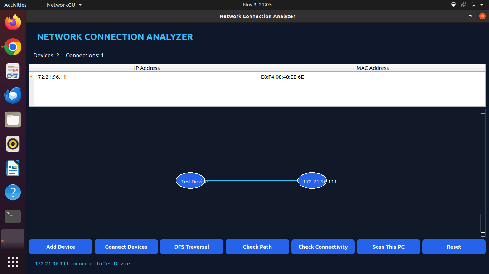

# 🌐 Network Connection Analyzer

<p align="center">
  
</p>

<h3 align="center">A Graph-Based Network Monitoring Application Built with C++ and Qt5</h3>

<p align="center">
  
  
  
  
</p>

---

## 🌐 Live Web Application

Try the browser-based version:

**[🚀 Launch Network Connection Analyzer](https://network-connection-analyzer-web-ver.vercel.app/)**

The web edition supports:
- Device management
- Network graph visualization
- Device connections
- DFS traversal
- Path checking using BFS
- Automatic saving using browser local storage

## ✨ Overview

**Network Connection Analyzer** is a network monitoring and graph visualization project developed using C++ and Qt5, with an additional browser-based web version.

The desktop application combines network connectivity testing with graph-based device representation and traversal algorithms. The web version demonstrates network topology management and graph operations through an interactive interface.

## 🚀 Key Features

| Feature | Description |
|---|---|
| 🌐 IP Detection | Detects the current system's IP address |
| 🔐 MAC Detection | Retrieves the active interface's MAC address |
| 💻 Device Management | Allows users to add devices manually |
| 🔗 Network Connections | Creates connections between devices |
| 📊 Graph Visualization | Displays devices and connections visually |
| 🔍 DFS Traversal | Performs Depth First Search |
| 🛣️ Path Checking | Checks whether a path exists between devices |
| 📡 Connectivity Testing | Checks IP reachability using ping (desktop) |
| ⚡ Latency Measurement | Displays response time in milliseconds (desktop) |
| 💾 Automatic Saving | Saves web network data using local storage |
| 🔄 Reset | Clears the current graph and device table |
| 🖥️ Desktop Launcher | Supports one-click launching with a custom icon |

## 🛠️ Technologies Used

- **C++** — Core programming language
- **Qt5 Widgets** — Graphical user interface
- **Qt5 Network** — Network interface information
- **Nmap** — Local host discovery
- **HTML** — Web page structure
- **CSS** — Web interface styling
- **JavaScript** — Web application logic
- **Vercel** — Web deployment and hosting
- **Linux / Ubuntu** — Development environment
- **Git & GitHub** — Version control

## 🧠 Data Structures & Algorithms

| Concept | Implementation |
|---|---|
| Graph | Represents network devices |
| Adjacency List | Stores device connections |
| QMap | Stores graph nodes (desktop) |
| QSet | Stores neighbouring and visited nodes (desktop) |
| JavaScript Map and Set | Stores web graph data |
| DFS | Traverses the graph |
| Graph Search | Checks connectivity and paths |
| BFS | Finds paths between connected devices in the web version |

## 🖥️ Application Interface

<p align="center">
  
</p>

The desktop application includes:

- A device information table showing IP and MAC addresses.
- A graphical network area displaying nodes and connections.
- Controls for scanning, adding devices, and connecting nodes.
- Connectivity and latency results.

## 🎥 Project Demo Video

Watch the Network Connection Analyzer in action:

**[▶️ Watch Network Connection Analyzer Demo](https://github.com/yuvikasaini30/Network-Connection-Analyzer/releases/download/v1.0/Network-Connection-Analyzer-Demo.mp4)**

## ⚙️ Installation & Setup

### 1. Install dependencies

```bash
sudo apt update
sudo apt install g++ qtbase5-dev libqt5network5 nmap
```

### 2. Clone the repository

```bash
git clone https://github.com/yuvikasaini30/Network-Connection-Analyzer.git
```

### 3. Navigate to the project

```bash
cd Network-Connection-Analyzer
```

### 4. Compile

```bash
g++ gui.cpp -o NetworkGUI $(pkg-config --cflags --libs Qt5Widgets Qt5Network) -fPIC
```

### 5. Run

```bash
./NetworkGUI
```

## 🌐 Access the Web Version

Open the deployed application:

**[Network Connection Analyzer – Live Website](https://network-connection-analyzer-web-ver.vercel.app/)**

No installation is required for the browser version.

## 🖱️ Desktop Launching

The project also includes a `launch.sh` script for launching the GUI through a configured Linux desktop shortcut.

## ⚠️ Project Scope

The desktop scanner currently detects the local system's active network interface. Additional devices and graph connections can be added manually.

The graph represents configured connections; it does not automatically discover the physical network topology.

The browser version demonstrates graph operations and manually configured network devices. Physical IP/MAC detection and ping-based connectivity testing are available in the native desktop application.

## 👩‍💻 Developer

**Yuvika Saini**

- UID: `25BCS13336`
- Section: `705A`
- BE Computer Science and Engineering
- Chandigarh University

## 🎓 Academic Project

- **Subject:** Advanced Data Structures
- **Project Title:** Network Connection Analyzer
- **Academic Session:** July–December 2026

---

<p align="center">
  <b>Built with 💙 using C++, Qt5, HTML, CSS and JavaScript</b>
</p>
